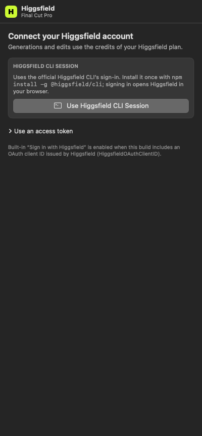
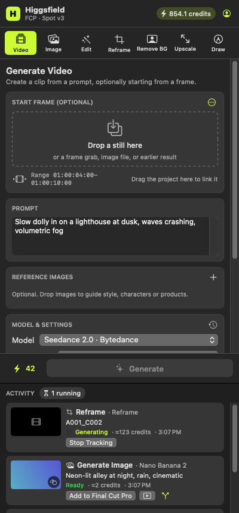
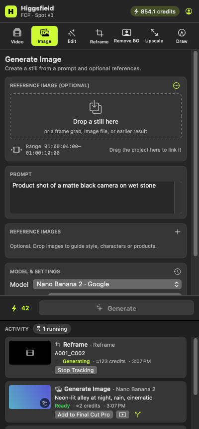
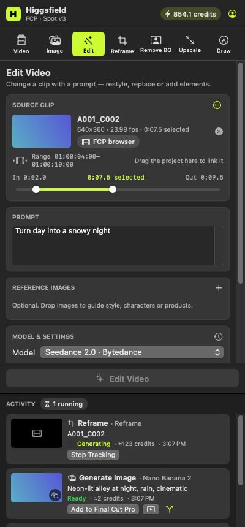
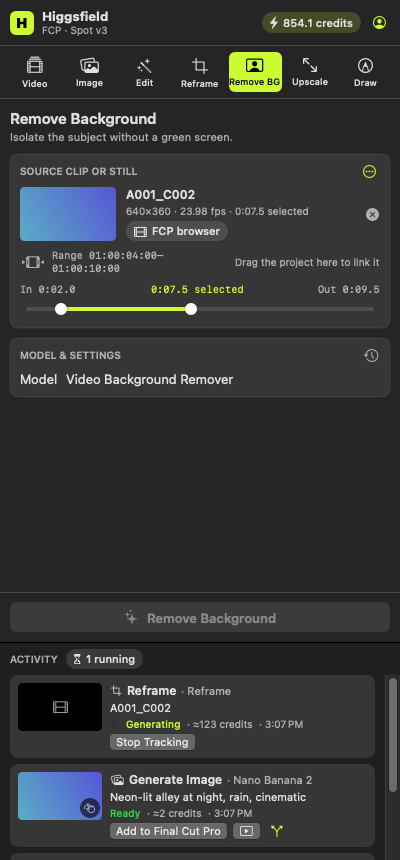
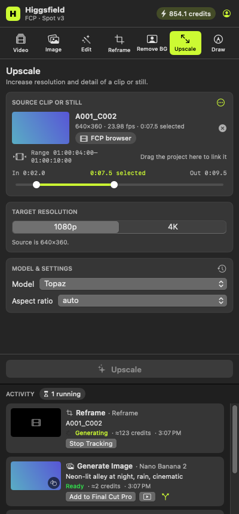

# Panel snapshots

Rendered offscreen by `PanelTests.testRenderPanelSnapshots` on macOS CI for `71be021e41215f7c9823cb85f76c238bb17a4d25` (branch `claude/fcp-edition`).

## 01-sign-in

## 02-generate-video

## 03-generate-image

## 04-edit-video

## 05-reframe

## 06-remove-background

## 07-upscale

## 08-draw-to-edit

