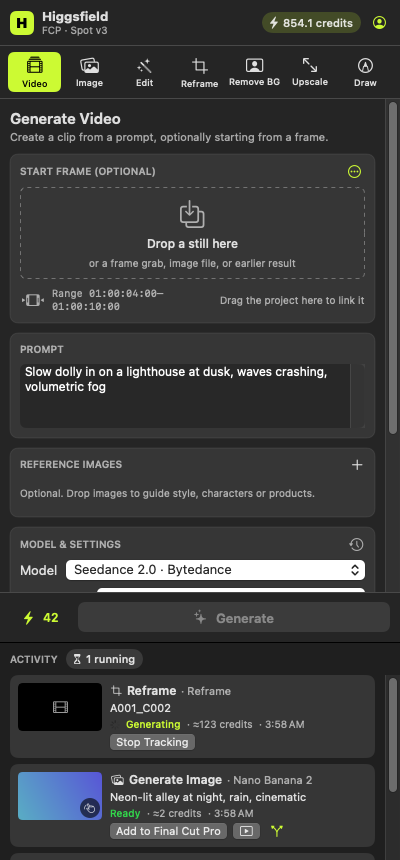
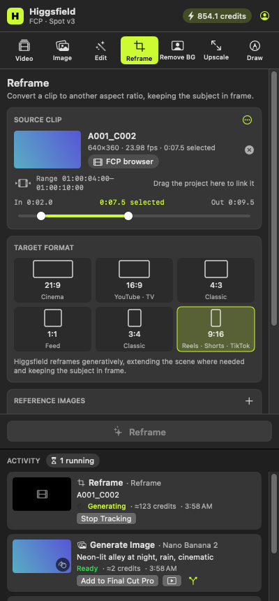
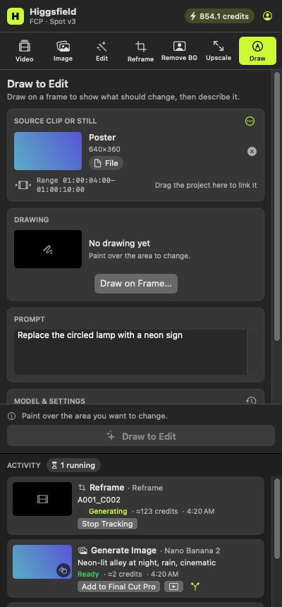

# Higgsfield for Final Cut Pro

A Final Cut Pro edition of the [Higgsfield Premiere Pro plugin](https://higgsfield.ai/plugins/premiere-pro). It is a compact panel inside Final Cut Pro with the same seven AI tools, running on your Higgsfield account and plan credits:

**Generate Video · Generate Image · Edit Video · Reframe · Remove Background · Upscale · Draw to Edit**

<p>  </p>

<sub>Rendered offscreen on macOS CI (`PanelTests.testRenderPanelSnapshots`); all screens are in [docs/screenshots](docs/screenshots).</sub>

## Workflow

1. **Open** Higgsfield from the Extensions button in Final Cut Pro's toolbar, or **Window ▸ Extensions ▸ Higgsfield**.
2. **Bring in footage.** Drag a clip from the FCP browser (a selected range is kept), or drag your project once and click **Use Clip at Playhead / Use Range**. Use **File ▸ Share ▸ Higgsfield** for rendered timelines.
3. **Configure.** Write a prompt, pick a model, and adjust the settings, which come from Higgsfield's live model catalog. The credit estimate shows on the button.
4. **Generate** (⌘↩). Activity shows each job's progress and a preview. Several jobs can run at once, and they survive closing the panel.
5. **Bring it back.** Drag the result onto the timeline, where it lands at the drop point, or click **Add to Final Cut Pro** (or turn on auto-add) to import it straight into the open library. Prompt, model and job ID go in the clip's Notes.

Details on each feature and how it maps to Premiere are in **[docs/PARITY.md](docs/PARITY.md)**.

## Status

The code is complete for all seven tools. It is built and tested in CI on macOS (app and Final Cut Pro extension) and Linux (core library). The Higgsfield requests match those of Higgsfield's official CLI, and the FCPXML validates against Apple's DTD.

It has **not yet been run against the live Higgsfield API through this app, or inside Final Cut Pro**. The build environment had neither network access to Higgsfield nor a Mac. [docs/VALIDATION.md](docs/VALIDATION.md) lists exactly what is verified and gives a checklist plus an opt-in CI job to close the remaining gaps.

## Build and install (personal setup)

Requirements: macOS 13+, Xcode 15+, [XcodeGen](https://github.com/yonaskolb/XcodeGen), Final Cut Pro 10.6+, and a free Apple ID in Xcode. No paid developer account is needed.

```sh
brew install xcodegen
scripts/configure-workflow-sdk.sh        # optional: enables live playhead/range if Apple's Workflow Extension SDK is installed
xcodegen generate --spec App/project.yml
open App/HiggsfieldFCP.xcodeproj
```

1. In Xcode, select each of the two targets (**HiggsfieldFCP** and **HiggsfieldWorkflowExtension**). Under **Signing & Capabilities**, pick your Apple ID; *Personal Team* is fine. No extra capabilities are needed.
2. Build the **HiggsfieldFCP** scheme (⌘B), choose **Product ▸ Show Build Folder in Finder**, and copy *Higgsfield for Final Cut Pro.app* to `/Applications`.
3. Launch it once. That registers the extension with Final Cut Pro.

### Signing in

Install the official Higgsfield CLI once:

```sh
npm install -g @higgsfield/cli
```

Then click **Use Higgsfield CLI Session** in the panel. If the CLI isn't signed in yet, it opens Higgsfield's sign-in page in your browser. After that the panel reuses the CLI's login, and the CLI renews it as needed.

You can also paste an access token from `hf auth token`. A built-in "Sign in with Higgsfield" button exists in the code, but it needs an OAuth client ID that only Higgsfield can issue, so it stays hidden.

### Where things live

| What | Where |
|---|---|
| Generated and processed media | `~/Movies/Higgsfield/<date>/` (Final Cut Pro imports from here) |
| Job history, settings, the sign-in token | `~/Library/Application Support/HiggsfieldFCP/` (the token is a private file, readable only by you, the same way the CLI keeps its own login) |
| Renders from **File ▸ Share ▸ Higgsfield** | the `Inbox` folder inside the above |

### Share destination (rendered timelines)

In Final Cut Pro, go to **File ▸ Share ▸ Add Destination**, add **Export File**, name it "Higgsfield", and set *Open with* to *Higgsfield for Final Cut Pro*.

## Repository layout

| Path | Contents |
|---|---|
| `Sources/HiggsfieldKit` | Foundation-only core: Higgsfield account API client, auth (OAuth PKCE, CLI bridge), JSON-schema model settings, the seven operations, job runner, FCPXML parse/build, timeline resolver |
| `Sources/HiggsfieldPanel` | SwiftUI panel, AVFoundation media helpers, credential storage, FCP host bridge, drag and drop, FCP import |
| `App/` | XcodeGen spec, container app, Final Cut Pro workflow extension |
| `Sources/hfcp` | Command-line harness for validating against the live API |
| `Tests/` | Contract, operation, job, FCPXML and panel tests |
| `docs/` | [PARITY](docs/PARITY.md), [VALIDATION](docs/VALIDATION.md), [API-CONTRACT](docs/API-CONTRACT.md), [FCP-INTEGRATION](docs/FCP-INTEGRATION.md), [RESEARCH](docs/RESEARCH.md) |
| `tools/` | Catalog snapshot and generator, DTD fetcher |

## Notes

- Results are saved to `~/Movies/Higgsfield/<date>/`, where Final Cut Pro can import them.
- Higgsfield's account API has no cancel endpoint. *Stop Tracking* stops waiting locally; the job still completes and is billed.
- Optional, if you ever sign with a paid developer team: set `HIGGSFIELD_APP_GROUP` and `HIGGSFIELD_KEYCHAIN_GROUP` in `App/project.yml` and add the matching App Group and Keychain Sharing entitlements to both targets. The panel then uses them instead of the shared folder. This isn't needed for personal use.
